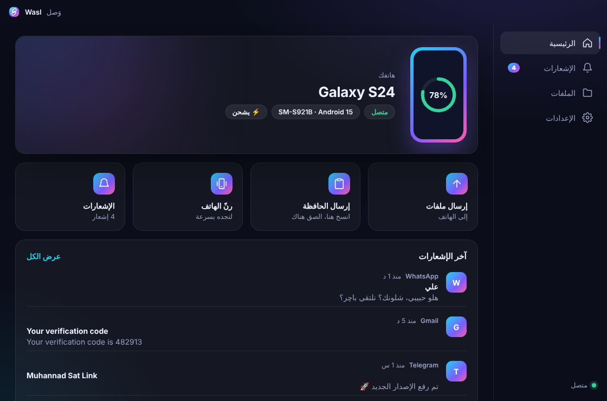

<div align="center">


# وَصل · Wasl

**هاتفك وحاسبتك، متصلان.** · **Your phone and your PC, connected.**

إشعارات، حافظة، ملفات، والبحث عن الهاتف — بين أندرويد وويندوز/لينكس.
مشفّر بالكامل، على شبكتك المحلية فقط، بدون حساب وبدون سحابة.

[](https://github.com/tara44x-code/Wasl/actions/workflows/build.yml)
[](https://github.com/tara44x-code/Wasl/releases/latest)

**تطوير Muhannad Sat Link**

</div>

<p align="center"></p>

## التحميل

من صفحة [Releases](https://github.com/tara44x-code/Wasl/releases/latest):

| الجهاز | الملف |
|---|---|
| ويندوز 10 / 11 | `Wasl-Setup-x.y.z.exe` |
| أندرويد 8 فما فوق | `Wasl-x.y.z.apk` |
| لينكس | `Wasl-x.y.z-x86_64.AppImage` أو `.deb` |

> ويندوز قد يُظهر تحذير SmartScreen لأن المثبّت غير موقّع: اضغط **More info** ثم **Run anyway**.

## طريقة الربط

1. ثبّت وصل على الحاسبة والهاتف، وتأكد أنهما على نفس الواي فاي.
2. في الحاسبة اضغط **عرض رمز الربط**.
3. في الهاتف اضغط **امسح رمز QR** ووافق على الربط.
4. فعّل **الوصول إلى الإشعارات** و**العمل في الخلفية** من شاشة الإعداد في التطبيق.

## الميزات

- **الإشعارات** على الحاسبة مع الرد المباشر، أزرار الإجراءات، الحذف المتزامن، وزر **نسخ الرمز** لرموز التحقق.
- **الحافظة**: انسخ على الحاسبة والصق على الهاتف تلقائياً، ومن الهاتف عبر زر، أو مربع الإعدادات السريعة، أو المشاركة.
- **الملفات** في الاتجاهين: اسحب وأفلت على الحاسبة، أو **مشاركة ← وصل** على الهاتف. يتم التحقق من كل ملف بـ SHA-256.
- **الروابط والنصوص**: شارك رابطاً من الهاتف فيُفتح في متصفح الحاسبة.
- **رنّ الهاتف** بصوت عالٍ حتى لو كان صامتاً.
- **البطارية** وحالة الشحن على الحاسبة.
- واجهة عربية وإنجليزية، سمة داكنة وفاتحة، وتعمل من شريط المهام.

## الأمان

- الربط بمفتاح عشوائي 256-bit داخل رمز QR فقط، ولا يمر عبر الشبكة أبداً.
- كل اتصال يشتق مفاتيح جديدة (HMAC-SHA256)، وكل رسالة مشفّرة بـ AES-256-GCM مع عدّاد يمنع الإعادة والتلاعب.
- المفتاح محفوظ في Android Keystore على الهاتف، وبـ DPAPI على ويندوز.
- يعمل على الشبكة المحلية فقط (منفذ TCP 47800 و UDP 47801).

التفاصيل في [docs/PROTOCOL.md](docs/PROTOCOL.md).

---

## English

Wasl links your Android phone with your Windows or Linux PC over your local network:
notifications (with replies and actions), clipboard sync, files both ways,
shared links, battery status and Find my phone. End-to-end encrypted, no account, no cloud.

### Build from source

```bash
# PC app (Electron)
cd desktop && npm install && npm start      # run
npm test                                    # protocol tests
npx electron-builder --win                  # Windows installer

# Android app
cd android && ./gradlew assembleRelease
```

Pushing a tag such as `v1.0.0` builds the Windows installer, the Linux AppImage/.deb and
the APK on GitHub Actions and publishes them as a release.
To sign the APK with a stable key, add the repository secrets `WASL_KEYSTORE_B64`,
`WASL_KEYSTORE_PASSWORD`, `WASL_KEY_ALIAS` and `WASL_KEY_PASSWORD`.

### Project layout

```
desktop/   Electron app for Windows and Linux (Node, no native modules)
android/   Kotlin + Jetpack Compose app
docs/      Protocol description and screenshots
```

MIT License © 2026 Muhannad Sat Link
